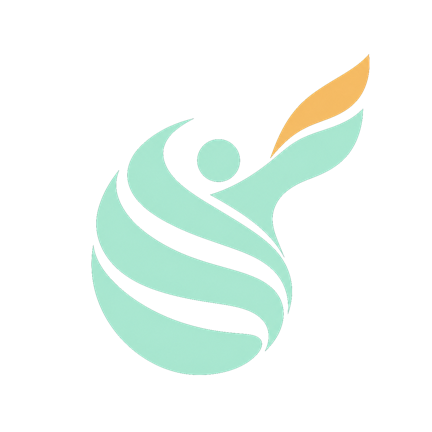

# 破茧 Logo · v1



层叠的弧带代表反复包裹的信息，向外打开的翼形代表视野展开，暖金色代表突破边界后遇见的新信息。

生成方式：内置 image_gen（imagegen 技能），全新生成，非透明背景。

此版本已用作 App 启动图标。仓库保留五种屏幕密度的图标资源，并为自适应图标预留裁切空间，保留右上方的金色翼尖。Android 13 及以上的主题图标使用从同一原图提取的单色轮廓。原始大图可从 [v0.5.43 历史版本](https://github.com/Yurken/PoJian/blob/v0.5.43/docs/brand/pojian-logo-v1.png) 获取。

## 生成提示词

```text
Use case: logo-brand.
Asset type: a finished, distinctive Android app icon for the Chinese app 破茧, an app about breaking out of information cocoons and discovering broader perspectives.
Primary request: Visually express “突破信息茧房” — breaking through a closed information cocoon.
Create ONE polished icon, not a presentation sheet, with no lettering.
Design: a strong, compact, beautifully balanced abstract cocoon formed from three broad, nested, smoothly curving ribbons, suggesting recurring streams of information enclosing a person. The enclosure deliberately opens at the upper right; its innermost ribbon transforms seamlessly into a bold, uplifting wing extending outward through that opening. The silhouette should evoke both a cocoon opening and the first unfolding wing of a butterfly, without illustrating a literal insect. Make the transition from enclosed loops to the outward wing the unmistakable central idea. Use clean negative space, confident curves, optical balance, a memorable silhouette and very few parts. The opening has one restrained warm amber accent, as a glimpse of new light and perspective.
Style: exceptional contemporary brand identity, flat vector-like graphic, precise crisp edges, substantial shapes readable at 48px, mature and humane.
Palette: solid very dark forest green #102F2A full-bleed background, mint green #A7E5CE main symbol, restrained warm amber #F2BE68 accent. No gradients or texture.
Composition: square 1:1, the single symbol optically centered and occupying approximately 66 percent of the canvas, generous safe margins for Android circular and rounded-square masking. Background extends to all four canvas edges; do not draw a separate icon tile or rounded border.
Constraints: no text, no letters, no words, no watermark, no mockup, no 3D, no shadows, no glow, no stock swoosh, no brain, no eye, no padlock, no shattered-glass debris, no tiny particles, no delicate hairlines. The result must look like a usable premium app logo, not an illustration.
```
